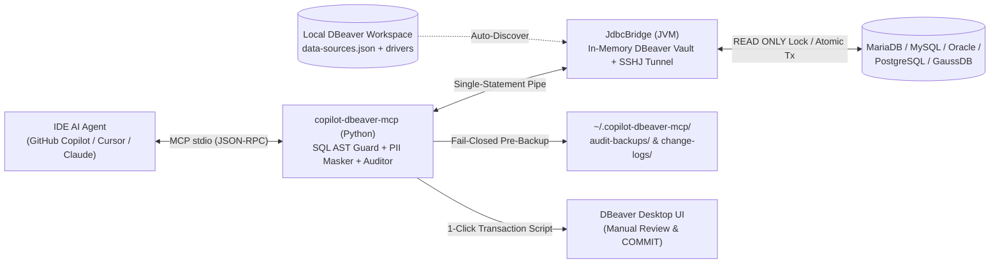

# Copilot DBeaver MCP

[](./LICENSE)
[](https://www.python.org/)
[](https://adoptium.net/)
[](https://modelcontextprotocol.io/)

**[简体中文文档 (Chinese README)](./README.zh-CN.md)** | **[Security Architecture](./SECURITY.md)**

**Copilot DBeaver MCP** is a zero-password, defense-in-depth **Model Context Protocol (MCP)** server that bridges AI coding assistants (**GitHub Copilot** in IntelliJ IDEA & VS Code, **Cursor**, **Claude Code / Desktop**) with the databases already configured in your local **DBeaver** — across **MariaDB, MySQL, Oracle, PostgreSQL, GaussDB, and H2** on Windows, macOS, and Linux.

It is purpose-built for **both daily feature development and production-grade incident debugging**: generating code against real schemas, validating query plans, seeding & cleaning up local integration test data, safely reviewing schema migrations (DDL), and remediating corrupted records with mandatory backups and audit logs.

---

## Key Features

- **Zero-Password DBeaver Reuse (Including SSH Tunnels)**
  Automatically discovers connections, cached JDBC drivers, and SSH tunnels from your local DBeaver workspace (`workspace6`). Credentials are decrypted **strictly in JVM memory** — never written to config files, logs, or exposed to the LLM.
- **Protocol & Engine-Level Read-Only Lock**
  Diagnostic tools (`diagnose_query`, `inspect_schema`, `explain_query`) strip multi-statement flags (`allowMultiQueries=false`), enforce `Connection.setReadOnly(true)` + `SET SESSION TRANSACTION READ ONLY` (`SET TRANSACTION READ ONLY` on Oracle), apply query timeouts and row caps, and always `ROLLBACK` on close.
- **Anomaly-Preserving Dynamic PII Masking**
  Automatically masks sensitive columns and values (IDs, names, phones, emails, secrets) before returning results to cloud LLMs — while preserving **`NULL` vs empty string `""`, character length, and leading/trailing whitespace** (`J***h [MASKED:PII len=12 trail_ws=2]`) so AI can still spot data corruption!
- **Rolled-Back Transactional Previews (`preview_remediation`)**
  Tests `UPDATE / DELETE / INSERT` fixes inside a real database transaction (`START TRANSACTION` $\rightarrow$ pre-`SELECT` $\rightarrow$ DML $\rightarrow$ post-`SELECT` $\rightarrow$ **`ROLLBACK`**), verifying constraints and returning exact row diffs with zero persistence.
- **Fail-Closed "No Backup, No Modification" & Dual Audit Ledger**
  Every modification — whether handed off to DBeaver (`open_remediation_in_dbeaver`) or committed locally (`apply_remediation`) — **must** first persist three backup artifacts (`backup_record.json`, `before_rows_insert.sql`, and primary-key-accurate `rollback.sql`) and append to `modification_audit.md` & `modification_audit.jsonl`.

---

## Architecture



---

## Prerequisites

- **Python** `3.10+`
- **JDK** `17+` (`java` and `javac` on `PATH`)
- **DBeaver** (Community or PRO) with at least one saved database connection (`Save password` checked) and downloaded driver

---

## Quick Start

### 1. Install

```bash
git clone https://github.com/kasonye/copilot-dbeaver-mcp.git
cd copilot-dbeaver-mcp
pip install -e .
```

Verify your environment, JDBC drivers, and DBeaver connection discovery:

```bash
copilot-dbeaver-mcp --doctor
```

### 2. Connect to GitHub Copilot (IntelliJ IDEA / VS Code)

Add `copilot-dbeaver-mcp` to your global MCP configuration so it works across **every project** without adding files to business repositories:

- **IntelliJ IDEA / JetBrains IDEs**:
  - Windows: `%LOCALAPPDATA%\github-copilot\intellij\mcp.json`
  - macOS / Linux: `~/.config/github-copilot/intellij/mcp.json`
- **VS Code**:User `mcp.json` (Command Palette $\rightarrow$ `MCP: Open User Configuration`)

```json
{
  "servers": {
    "copilot-dbeaver-mcp": {
      "type": "stdio",
      "command": "copilot-dbeaver-mcp",
      "args": []
    }
  }
}
```

*(Tip: If `copilot-dbeaver-mcp` is not on your global PATH, set `"command": "/path/to/python"` and `"args": ["-m", "copilot_dbeaver_mcp"]`.)*

---

## Exposed MCP Tools (12 Tools)

| Tool | Mode | Description |
| :--- | :--- | :--- |
| `scan_recent_db_errors_in_logs` | Read-Only | Scans project logs for SQL/JPA/Hibernate/constraint exceptions and highlights application stack frames. |
| `list_connections` | Read-Only | Lists all auto-discovered DBeaver connections, drivers, and SSH tunnel status (zero secrets exposed). |
| `list_databases` | Read-Only | Lists available databases / schemas on a specified DBeaver connection. |
| `inspect_schema` | Read-Only | Inspects tables, columns, data types, nullability, primary keys, foreign keys, and table DDL. |
| `explain_query` | Read-Only | Runs `EXPLAIN` to check index usage before querying large tables. |
| `diagnose_query` | Read-Only | Runs a single `SELECT / SHOW / DESCRIBE` inside a `READ ONLY` transaction with PII masking. |
| `preview_remediation` | Dry-Run (`ROLLBACK`) | Runs target DML inside a rolled-back transaction, returning before/after diffs and generating a DBeaver `.sql` script. |
| `open_remediation_in_dbeaver` | Backup + Handoff | Backs up original rows + logs the operation, then opens a manual-transaction `.sql` script (`SET autocommit=0; ... ROLLBACK;`) in DBeaver. |
| `apply_remediation` | Backup + Atomic Commit | Allowed only on `allow_direct_apply_connections` (default: `localhost`). Persists full backups + audit logs before row-count-locked commit. |
| `open_ddl_migration_in_dbeaver` | Schema Snapshot + DDL Handoff | Validates `CREATE/ALTER TABLE` & `INDEX` DDL (blocks `DROP TABLE/DATABASE`), snapshots existing DDL, optionally writes a Flyway file, and opens DBeaver with paired reverse DDL. |
| `seed_dev_test_data` | Local Dev Seed + 1-Click Cleanup | Atomically inserts structured test rows on allowed dev connections (with PK collision pre-check) and generates a consolidated `DELETE ... WHERE pk IN (...)` cleanup backup. |
| `list_modification_history` | Read-Only | Queries chronological modification audit logs, field diffs, backup bundles, and `rollback.sql` paths. |

---

## Configuration (Optional)

Copy [`config.example.yaml`](./config.example.yaml) to `~/.copilot-dbeaver-mcp/config.yaml` (or `./config.local.yaml`). Changes are **hot-reloaded** on every tool call without restarting your IDE.

---

## Running Tests

```bash
python -m unittest discover -s tests -v
```

---

## License

Released under the [MIT License](./LICENSE).
